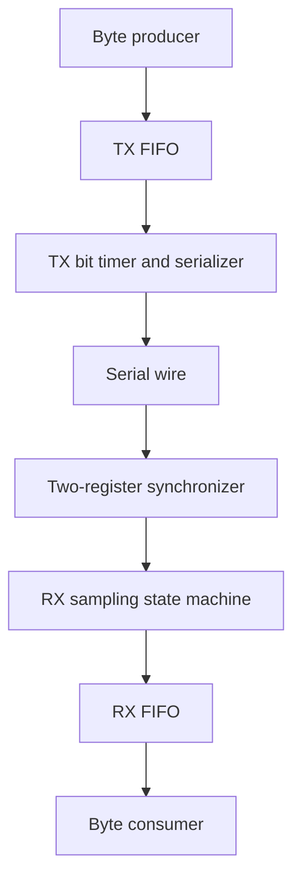

# Architecture

The producer writes bytes to a TX FIFO using ready/valid. When the transmitter is idle, it consumes the old FIFO head and latches `{stop, byte, start}` into a ten-bit register. A local counter holds each output bit for CLKS_PER_BIT clock cycles. The transmitter emits one idle clock before accepting the next frame.

The receive pin passes through two clocked registers. RX's state machine checks the start bit at half a bit interval, reads eight centered data bits, and checks the stop bit. A completed valid byte enters a separate RX FIFO. The consumer can pause without blocking reception until this FIFO fills. A UART wire cannot be backpressured by the FIFO; overflow therefore drops newest and latches an error.

## Timing boundaries

Each FIFO has combinational head data and synchronous pointer updates. TX reads old head data at the same rising edge that pops it. Nonblocking assignments preserve that meaning in simulation. Queue memory is a register-array model; mapping to a synchronous block RAM would require adapting its read timing.

The RX complete pulse is registered; the FIFO consumes that byte on the next rising edge. The error logic detects an overflow on that same FIFO write edge. Data and received_valid are held coherently through that edge. Ready at full occupancy is asserted when a pop will free a slot on the current edge.

## RX states

IDLE detects low; START validates at half a bit; DATA collects bits 0–7; STOP validates the stop bit; RECOVER waits for high after a framing error. Reset returns to idle and clears status. Low during reset is not a valid frame boundary guarantee: keep the external line idle during initialization.

## Deliberate tradeoffs

An integer divider keeps implementation small but introduces baud quantization. Single center sampling is simpler than 16x oversampling with voting, but is less robust to noise. Independent queues isolate application bursts but cannot prevent wire overflow indefinitely. Sticky flags preserve fault visibility but do not count distinct errors. No cross-clock FIFO is needed: only the serial input crosses into this single clock domain.
