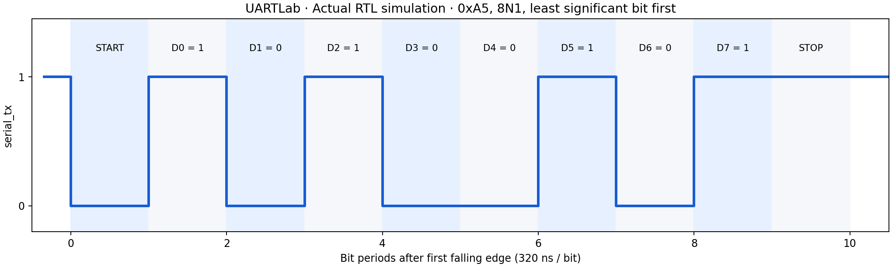

# UARTLab

[Live demo](https://uartlab.vercel.app/) · [Public source](https://github.com/CodeWith-Pranav/UARTLab)

A simulation-only digital design project: an 8N1 UART with independent transmit and receive FIFOs, ready/valid interfaces, error reporting, and self-checking SystemVerilog testbenches. No board, components, paid tools, database, or AI API required.



## Start here

On Ubuntu, Debian, or Windows WSL Ubuntu:

```sh
sudo apt-get update
sudo apt-get install -y iverilog gtkwave make
make test
gtkwave results/uart-cpb32.vcd
```

On macOS with Homebrew: `brew install icarus-verilog make`; use a compatible VCD viewer for waveforms. The tested environment is Icarus Verilog 11.0 on Linux. Windows users can install free WSL Ubuntu and run the commands above inside it. Python is only needed to regenerate the optional PNG:

```sh
python3 -m pip install -r requirements-plots.txt
python3 tools/plot_waveform.py
```

`make test` exits unsuccessfully if an assertion fails. Success prints `PASS` messages and produces two VCDs. The included logs and VCDs are actual runs, not illustrative results. A fresh run overwrites them.

## Features

- TX serializes bytes LSB first: one low start bit, eight data bits, one high stop bit.
- RX synchronizes the asynchronous pin through two registers and samples each bit near its center.
- False-start rejection; a bad stop bit discards the frame and sets a sticky error.
- Independent parameterized FIFOs, including non-power-of-two depths.
- RX overflow discards the newest byte and preserves queued bytes.
- Ready/valid backpressure; simultaneous FIFO reads and writes, including full replacement.
- Synchronous active-high reset aborts transmission and flushes queued data.
- Automated seeded FIFO scoreboard, independent serial stimulus, exhaustive byte loopback, fault injection, CI workflow.

## Read in this order

1. [Beginner guide](docs/BEGINNER-GUIDE.md): what the circuit does and how to learn it.
2. [Specification](SPEC.md): exact interfaces and policies.
3. [Architecture](ARCHITECTURE.md): how the modules cooperate.
4. [Verification](docs/VERIFICATION.md): tested cases, real evidence and limits.
5. [Interview guide](docs/INTERVIEW-GUIDE.md): explain design decisions honestly.
6. [Project status](PROJECT-STATUS.md): completed and remaining work.

## Repository map

| Path | Purpose |
|---|---|
| `rtl/sync_fifo.sv` | Synchronous single-clock FIFO |
| `rtl/uart_tx.sv` | Transmit state and timing |
| `rtl/uart_rx.sv` | Synchronizer and receive state machine |
| `rtl/uart_core.sv` | FIFO integration and sticky status |
| `tb/tb_fifo.sv` | Seeded 6,000-cycle reference-model test |
| `tb/tb_uart.sv` | Independent TX/RX checks, loopback and faults |
| `results/` | Actual simulation logs, VCDs and waveform plot |
| `.github/workflows/simulate.yml` | Ubuntu simulation and evidence artifact upload |

## Scope

Synthesizable-style RTL, simulated functional behavior. No FPGA synthesis, resource counts, static timing analysis, formal proof, silicon verification, power measurement or hardware validation is claimed. The two-register input synchronizer cannot be validated for analog metastability by this digital simulation. RX uses a single center sample; it does not implement majority-vote oversampling, parity, auto-baud, hardware flow control, or a CPU bus.

## GitHub setup

The public repository is https://github.com/CodeWith-Pranav/UARTLab. To use a separate copy under your own account, create a repository, unzip the project and run from its directory:

```sh
git init
git add .
git commit -m "Implement UART FIFOs and reproducible simulation suite"
git branch -M main
git remote add origin https://github.com/YOUR-USERNAME/UARTLab.git
git push -u origin main
```

Use your account name in the URL. The CI workflow runs automatically on push and pull requests. It checks the browser teaching model and runs the RTL simulations. Commit later edits as you make them. Keep the published simulation limitations visible. A Vercel frontend is optional for presentation; it does not execute or validate this RTL.

## Public demo

The `public/` folder contains a responsive teaching demo: an interactive 8N1 frame explorer, baud-divider calculator, FIFO model and actual simulation evidence. `public/logic.mjs` is an illustrative JavaScript model, not a Verilog engine. No browser action claims to run RTL remotely.

Run `node tools/test-site.mjs` to check the teaching model. Run `node tools/build-site.mjs` to decompress the checked-in VCD evidence into the download folder, then serve `public/` with `python3 -m http.server 8080 --directory public`. Vercel runs the preparation script automatically. There are no package dependencies or secrets.

The checked-in VCDs are losslessly compressed as `results/*.vcd.gz`; `make test` regenerates raw VCDs for GTKWave. Future pushes trigger GitHub simulation checks and Vercel deployments independently; passing CI is not a Vercel promotion gate.
